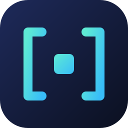

## Hi, I'm Berkay

I'm a software engineer and independent maker in Turkey, mostly working in C#/.NET and TypeScript.

### Open source

| | Project | What it is |
| --- | --- | --- |
|  | [unslop-skills](https://github.com/bberka/unslop-skills) | Agent skills that strip AI habits from text, code, tests, UI and commits. |
|  | [TrendyolClient.Sharp](https://github.com/bberka/TrendyolClient.Sharp) | Type-safe .NET client for the Trendyol APIs. |
|  | [TabLodge](https://github.com/bberka/TabLodge) | Save and restore tab sessions in Chromium and Firefox. Local first. |
|  | [LazyTools](https://github.com/bberka/lazytools.dev) | Privacy-first developer tools that run in the browser or offline. |
|  | [BitPack](https://github.com/bberka/BitPack) | Zero-allocation, native AOT C# bit-level serialization. |
|  | [BrightSync](https://github.com/bberka/BrightSync) | Keeps the brightness of your DDC/CI monitors in sync. |

### Elsewhere

[bbay.dev](https://bbay.dev) · [Blog](https://bbay.dev/blog/)
