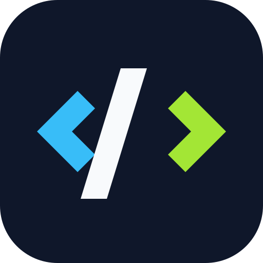
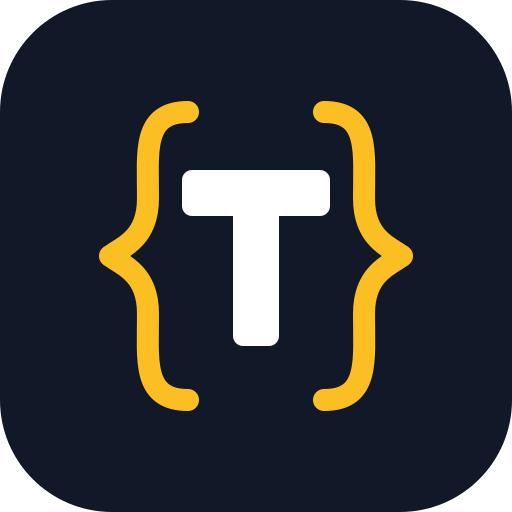

## Hi, I'm Berkay

I'm a software engineer and independent maker in Turkey, mostly working in C#/.NET and TypeScript.

### Projects

| | | | |
| :---: | --- | --- | --- |
|  | **MediaStash** | Track movies, TV, books and games. | [Website](https://mediastash.app/) |
|  | **TabLodge** | Tab sessions and bookmarks in one place. | [Website](https://tablodge.bbay.dev/) · [GitHub](https://github.com/bberka/TabLodge) |
|  | **LazyTools** | Private developer tools for browser and desktop. | [Website](https://lazytools.dev/) · [GitHub](https://github.com/bberka/lazytools.dev) |
|  | **Unslop Skills** | Find and remove AI slop in code, tests, UI and docs. | [GitHub](https://github.com/bberka/unslop-skills) |
|  | **Skills** | My agent skills for Claude Code, Codex and Cursor. | [GitHub](https://github.com/bberka/skills) |
|  | **BitPack** | Fast bit-level serialization for C#. | [GitHub](https://github.com/bberka/BitPack) |
|  | **TrendyolClient.Sharp** | Typed .NET client for the Trendyol API. | [GitHub](https://github.com/bberka/TrendyolClient.Sharp) |
|  | **BrightSync** | One brightness control for all your monitors. | [Website](https://bberka.github.io/BrightSync/) · [GitHub](https://github.com/bberka/BrightSync) |
|  | **Modmail.NET** | Modmail bot for Discord. | [GitHub](https://github.com/bberka/Modmail.NET) |

### Elsewhere

[bbay.dev](https://bbay.dev) · [Blog](https://bbay.dev/blog/)
